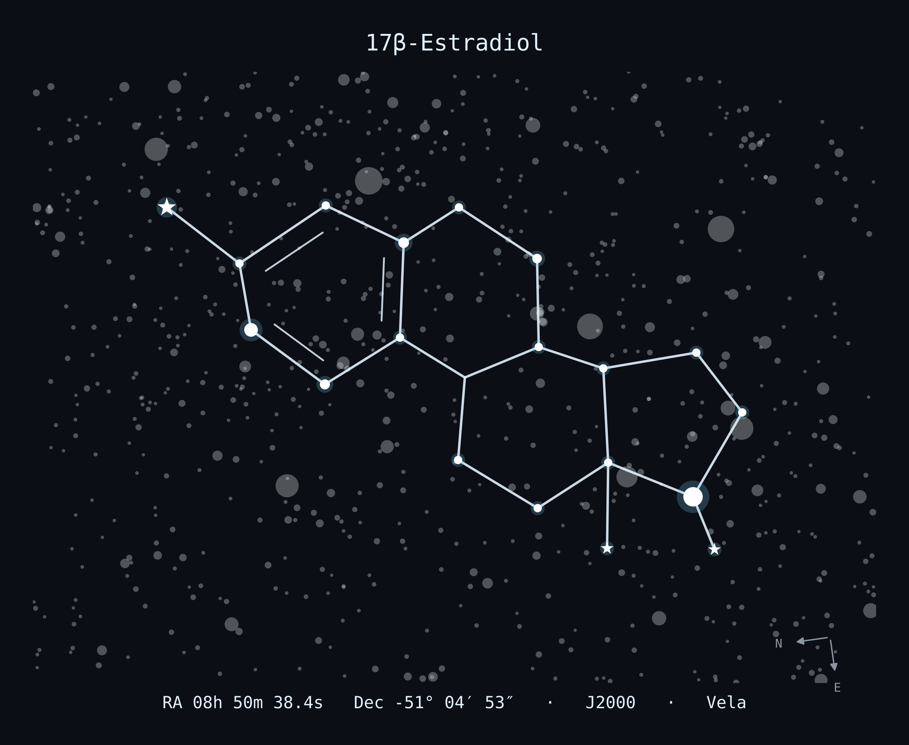
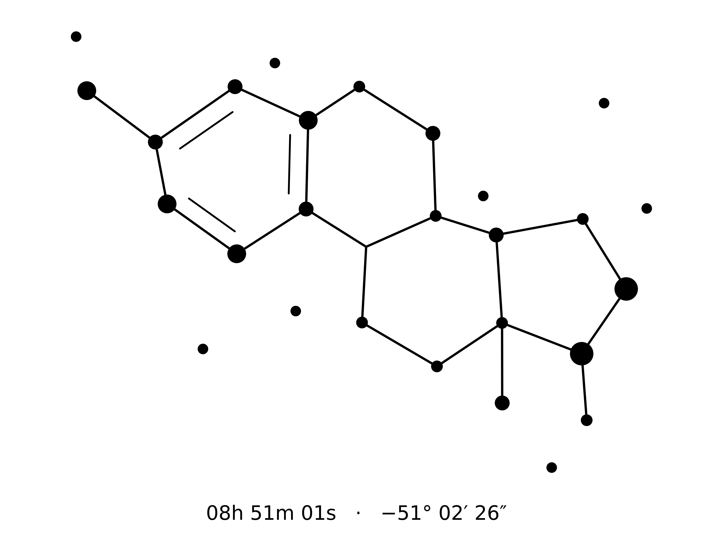

# astrocule

> [!WARNING]
> ## ⚠️ AI SLOP WARNING ⚠️
>
> This entire project was written by an AI (Claude) in a single chat session, with only light
> human review. The search is heuristic, the tests are few, and the astronomy, chemistry and
> coordinates have **not** been independently checked by anyone who knows what they're doing.
>
> **If you're putting any of this on your body:** look the stars up yourself (the JSON lists every
> HIP number) in a proper planetarium tool like Stellarium before anything gets inked.

Find a molecule's skeletal formula hidden among real stars.

Give it any molecule and it lays out the heavy-atom skeleton in 2D, searches the whole sky
(Hipparcos stars) for the set of stars that traces that skeleton with the least distortion,
lists the candidates sorted by distortion, and renders the best ones as star charts with their
J2000 coordinates.



## Usage

```sh
pip install -r requirements.txt

python astrocule.py estradiol                       # built-in name
python astrocule.py "CN1C=NC2=C1C(=O)N(C(=O)N2C)C" --title Caffeine   # any SMILES
python astrocule.py melatonin                       # anything else is looked up on PubChem
```

Built-in names: estradiol, testosterone, progesterone, spironolactone, serotonin, dopamine, caffeine.

The first run downloads the [HYG database](https://github.com/astronexus/HYG-Database) (about 34 MB)
to `~/.cache/astrocule`. A whole-sky search takes 5 to 10 minutes; `--region` is much faster. It prints a table of candidates
sorted by distortion, then a per-atom star list for the best few. Results go to `./out`: one chart
per charted candidate plus a JSON file with every candidate and every star (HIP number, RA/Dec,
magnitude) and how far it sits from its ideal atom position.

| option | default | what it does |
| --- | --- | --- |
| `--mag` | 6.5 | faintest star allowed in the figure. 6.5 is roughly naked eye under a dark sky |
| `--bond MIN MAX` | 1 3 | bond length on the sky in degrees |
| `--region RA DEC R` | whole sky | only figures centered within R degrees of RA/DEC |
| `--no-mirror` | | don't allow the mirror image of the drawing |
| `--skip` | 1 | let up to this many atoms go without a star (see below) |
| `--top` | 10 | number of candidates to list, sorted by distortion |
| `--charts` | 5 | number of the best candidates to chart and list star by star |
| `--north-up` | | draw charts north-up instead of turning the molecule upright |
| `--labels` | | label heteroatoms (O, N, ...) with their element |
| `--star-names` | | label named background stars |
| `--tattoo` | | also write stencil-ready line art (SVG + PNG) for every charted candidate |
| `--tattoo-stars N` | 8 | how many of the brightest nearby stars to add to the tattoo art |
| `--no-tattoo-text` | | leave the coordinates off the tattoo art |

## How it works

1. **Molecule.** RDKit parses the SMILES, kekulizes aromatic rings and draws a CoordGen 2D layout,
   scaled to unit bond length.
2. **Hypotheses.** The sky is split into tiles. In each tile, every pair of stars that could hold the
   molecule's two farthest-apart atoms defines one rotation + scale + shift. All atoms of that
   hypothesis are checked against the nearest stars, and hypotheses are pruned atom by atom as soon as
   they can't end up good.
3. **Refinement.** Survivors alternate a strict one-star-per-atom assignment (Hungarian algorithm) with
   a least-squares similarity fit until the assignment stops changing.
4. **Starless atoms.** With `--skip K`, up to K atoms may go without a star. Hypotheses tolerate K
   atoms with no star nearby, and refinement leaves out the K worst-fitting atoms (trimmed ICP). The
   search uses K+1 disjoint anchor pairs so that any K atoms can be the starless ones.
5. **Polish.** Each candidate is re-projected around its own center and refit, so the score and the
   chart share one nearly distortion-free frame. Projection is stereographic, which preserves shapes
   locally. While polishing, every atom is tried as the starless one, and the best figure is kept for
   each number of starless atoms from 0 to K.

The score is the RMSD between the stars and the ideal atom positions, in units of the bond length.
0.1 means stars are off by a tenth of a bond on average.

### Tattoo export

`--tattoo` writes `<name>_<rank>_tattoo.svg` and `.png` next to each chart. The art is black line work
meant to be handed to a tattoo artist: bonds, one dot per star in four sizes by brightness, a few of
the brightest nearby stars as small dots (kept clear of the lines and the edges), and the coordinates
underneath. The SVG has a transparent background and keeps the coordinates as editable text, so the
artist can swap the font. The PNG is white-backed at 600 dpi.

Fine lines spread a little in skin over the years. The inner lines of double bonds sit closest to
other lines, so ask your artist how small they'd go before those merge.



### Starless atoms

In a skeletal formula, carbons are just corners where lines meet. So an atom can go without a star
and the drawing still reads as the same molecule: the bonds simply meet at the ideal spot. Letting
one atom do that often removes the single worst-fitting star and lowers the distortion noticeably.
Scores are over the starred atoms only, so the list always shows the best match for every number of
starless atoms side by side. Use `--skip 0` to require a star on every atom.

Atom labels like `C2` count atoms in SMILES order, not the chemical numbering of the molecule. The
chart shows which corner is starless.

### Things to know

- Bigger figures always score better, because the same star density gives you more freedom relative
  to the bond length. So the best match will usually use close to the largest `--bond` you allow.
  Choose the size range you actually want.
- Dense parts of the Milky Way (Vela, Carina, Cygnus) tend to win for the same reason. The report's
  "stars inside the figure brighter than its median star" count tells you how much the figure would
  have to compete with other stars to the eye.
- Mirror images are allowed by default. A flat drawing has no stereochemistry, so a mirrored skeleton
  is still the same molecule as far as the drawing goes. Use `--no-mirror` if you care.
- Charts are rotated so the molecule sits upright. The N/E arrows show where north and east really are.
  East is on the left, as when looking up at the sky.
- Coordinates are J2000 and stellar proper motion is ignored, which is far below what you can see.

## Tests

```sh
python -m pytest tests
```

## Credits

Star data: [HYG database v4.1](https://github.com/astronexus/HYG-Database) by David Nash
(CC BY-SA 4.0), built on the Hipparcos catalog.
